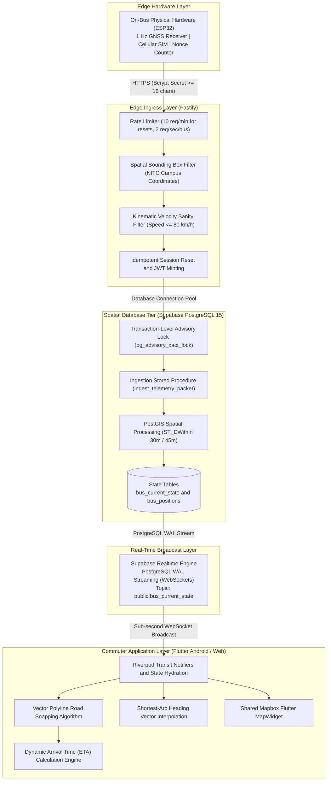
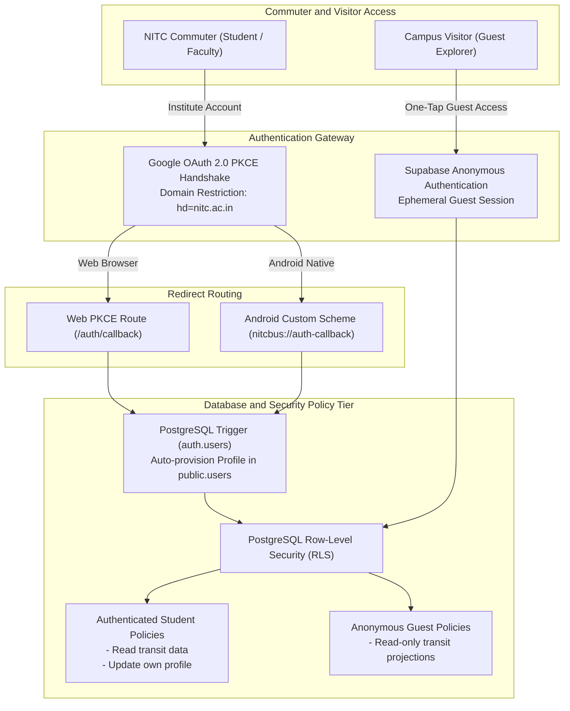
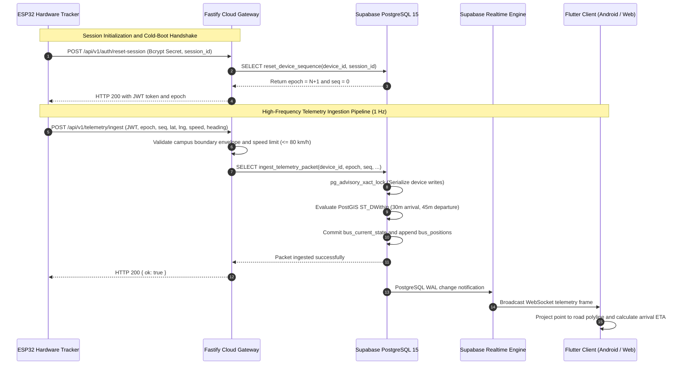

<p align="center">
  
</p>

# BusTracker: NITC Campus Transit Platform

[](https://github.com/SH1SHANK/nitc-bus-tracking-app/releases/tag/v1.0.0-rc-2)
[](https://github.com/SH1SHANK/nitc-bus-tracking-app/releases)
[](https://flutter.dev)
[](https://dart.dev)
[](https://fastify.io)
[](https://supabase.com)
[](supabase/AUTH_CONFIGURATION.md)
[](test/)
[](tool/verify_architecture.dart)
[](LICENSE)

BusTracker is an enterprise-grade campus transit tracking and arrival prediction platform engineered for the National Institute of Technology Calicut (NITC). Built on a high-throughput reactive architecture combining Flutter, Fastify, PostGIS, and Supabase Realtime, the platform eliminates transit uncertainty across the 300-acre campus through sub-second telemetry ingestion, road-snapped polyline mapping, automated virtual geofencing, and dead-reckoned arrival estimates.

---

## Executive Overview

Campus transit environments present unique geospatial challenges that off-the-shelf consumer mapping applications fail to resolve:
1. **Uncertain Wait Times:** Irregular loop frequencies and inter-hostel traffic bottlenecks create unpredictable waiting periods at campus stops.
2. **GPS Scattering:** Deep building corridors and dense tree canopy across the Calicut Western Ghats foothills cause multi-path GPS drift, making stationary buses appear to jump across buildings.
3. **Hardware Constraints:** On-bus cellular trackers operate in fluctuating carrier coverage zones, demanding rigorous deduplication, monotonic sequencing, and idempotent reboot recovery.

BusTracker solves these constraints through an integrated hardware-to-client pipeline. Physical ESP32 GNSS trackers transmit authenticated position payloads to a high-concurrency Fastify gateway, which verifies cryptographic hardware tokens, applies spatial sanity filters, and delegates state transitions to an advisory-locked PostgreSQL/PostGIS engine. Commuters consume real-time updates through an optimized Flutter application running on Android and modern Web browsers.

---

## Downloads and Live Access

| Platform | Channel | Link | Notes |
|---|---|---|---|
| **Web** | Production | [nitc-bustracker.vercel.app](https://nitc-bustracker.vercel.app) | HTML5 Canvas, WebAssembly, PWA-ready |
| **Android (Universal)** | Stable Release | [BusTracker-v1.0.0-rc-2-universal.apk](https://github.com/SH1SHANK/nitc-bus-tracking-app/releases/download/v1.0.0-rc-2/BusTracker-v1.0.0-rc-2-universal.apk) | Compatible with all Android architectures (API 21+) |
| **Android (ARM64-v8a)** | Optimized Release | [BusTracker-v1.0.0-rc-2-arm64-v8a.apk](https://github.com/SH1SHANK/nitc-bus-tracking-app/releases/download/v1.0.0-rc-2/BusTracker-v1.0.0-rc-2-arm64-v8a.apk) | Reduced binary footprint for modern smartphones |
| **Android (x86_64)** | Emulator Release | [BusTracker-v1.0.0-rc-2-x86_64.apk](https://github.com/SH1SHANK/nitc-bus-tracking-app/releases/download/v1.0.0-rc-2/BusTracker-v1.0.0-rc-2-x86_64.apk) | Android Studio emulators and ChromeOS |
| **Android App Bundle** | Production AAB | [BusTracker-v1.0.0-rc-2.aab](https://github.com/SH1SHANK/nitc-bus-tracking-app/releases/download/v1.0.0-rc-2/BusTracker-v1.0.0-rc-2.aab) | Google Play Store distribution artifact |
| **Checksums** | Verification | [checksums.sha256](https://github.com/SH1SHANK/nitc-bus-tracking-app/releases/download/v1.0.0-rc-2/checksums.sha256) | Cryptographic SHA-256 release signatures |

All previous releases and detailed changelogs are cataloged on the [GitHub Releases](https://github.com/SH1SHANK/nitc-bus-tracking-app/releases) portal.

---

## Technical Specifications and Version Matrix

| Component | Target Version | Runtime Environment | Specification Notes |
|---|---|---|---|
| **Client Application** | `1.0.0-rc-2+2` | Flutter `3.47.5` / Dart `3.13.4` | Pinned via `.fvmrc`, strict null safety |
| **State Architecture** | `flutter_riverpod` `3.4.3` | Dart VM / Web JavaScript | AsyncNotifier pattern with code isolation |
| **Client Routing** | `go_router` `18.0.2` | Native / Browser URL Engine | StatefulShellRoute with indexed navigation dock |
| **Design System** | Moon DS v1 (`1.1.0`) | Flutter Canvas | Solid contrast tokens, zero glassmorphism |
| **Telemetry Gateway** | Fastify `4.x` | Node.js `20.x` LTS | JSON Schema validation, rate limited |
| **Database Engine** | PostgreSQL `15` | Supabase Cloud | PostGIS `3.3`, RLS, transaction advisory locks |
| **Auth Provider** | Supabase Auth | OAuth 2.0 PKCE / GoTrue | Google SSO restricted to `@nitc.ac.in` domain |
| **Mobile OS Target** | Android 5.0 to 15 | Android API Level 21 through 35 | Target SDK 35, Min SDK 21 |
| **Web Distribution** | Vercel Edge | Vercel Serverless / CDN | Strict Content Security Policy, Brotli |

---

## System Architecture and Data Pipeline

BusTracker operates on a decoupled multi-tier architecture where edge hardware ingestion, spatial data persistence, real-time fanout, and client rendering maintain strict isolation boundaries.



### End-to-End Packet Lifecycle
1. **Hardware Emission:** On-bus ESP32 trackers obtain fix coordinates, ground speed, and heading vector at 1-second intervals. Payloads are tagged with a device identifier, session epoch, and monotonic sequence number.
2. **Gateway Verification:** The Fastify edge gateway validates the device authorization token, checks the coordinate against the NIT Calicut spatial envelope (`11.3100°N - 11.3350°N`, `75.9200°E - 75.9450°E`), rejects velocity spikes exceeding 80 km/h, and discards malformed packets.
3. **Atomic Database Ingestion:** Fastify forwards the packet to the `ingest_telemetry_packet` stored procedure. An advisory lock keyed to the device ID guarantees sequential isolation under cellular retries. If the sequence is valid, PostgreSQL:
   - Updates `bus_current_state` with current coordinates, heading, and timestamp.
   - Appends historical telemetry to `bus_positions` for path auditing.
   - Evaluates PostGIS 30-meter arrival circles and 45-meter departure radii against all campus stops.
4. **Client Visualization:** The updated state is broadcast over Supabase Realtime to subscribed Flutter clients. The app snaps the coordinate to the campus road polyline, updates the dynamic ETA, and animates marker rotation across the shortest angular arc.

---

## Authentication and Security Architecture

BusTracker enforces role-based access control with specialized authentication pipelines tailored to the campus ecosystem.



### Google OAuth 2.0 Integration
- **Institutional Domain Locking:** Authentication utilizes Supabase Auth with Google OAuth 2.0 configured with the hosted domain parameter `hd=nitc.ac.in`. Non-institute Google accounts are rejected at the OAuth consent boundary before reaching the application.
- **Deep-Link Resolution:**
  - **Android:** Custom scheme URI `nitcbus://auth-callback` configured with `autoVerify="true"` handles session capture directly into the mobile execution context.
  - **Web:** Standard relative resolution `/auth/callback` handles token exchange via Web PKCE.
- **Automated Profile Provisioning:** A PostgreSQL database trigger on `auth.users` automatically provisions a matching record in `public.users`, binding the user's `@nitc.ac.in` email, full name, and role permissions without manual registration steps.

### Guest Explorer Mode
For visitors, conference attendees, and campus guests, BusTracker provides instant one-tap Guest Mode via Supabase Anonymous Authentication. Guests receive an ephemeral session token granting read access to live maps, routes, and timetables without requiring email verification.

### Bot Protection
Authentication endpoints integrate Cloudflare Turnstile token validation on Web and Android shells, mitigating automated credential-stuffing and denial-of-service attempts.

---

## Supabase Backend Infrastructure

The database tier is architected in PostgreSQL 15 with the PostGIS spatial extension.

### Core Database Entities

| Table | Primary Key | Description |
|---|---|---|
| `buses` | `id` (UUID) | Fleet registry storing registration number, bus name, capacity, and active status. |
| `devices` | `id` (UUID) | Tracker hardware registry linking hardware `device_id` (Text) to `buses.id`. |
| `bus_current_state` | `bus_id` (UUID) | Materialized live state containing latest coordinate, heading, speed, and epoch. |
| `bus_positions` | `id` (BigInt) | Immutable time-series spatial log of all received GNSS points. |
| `stops` | `id` (UUID) | Official NITC transit stops with spatial point geometry (`geography(Point, 4326)`). |
| `routes` | `id` (UUID) | Named campus loops (Campus Inner Loop, East Campus Shuttle, Hostel Circular). |
| `route_stops` | `id` (UUID) | Ordered sequence of stops along a route, with scheduled dwell times. |
| `route_geometries` | `route_id` (UUID) | Normalized LineString vector geometry representing physical road paths. |
| `users` | `id` (UUID) | Student profile registry containing roll number, department, hostel, and role. |
| `admin_audit_logs` | `id` (BigInt) | Cryptographically signed administrative action logs for governance. |

### PostGIS Spatial Operations
- **Geofence Arrival & Departure:** Geofences are evaluated using `ST_DWithin(bus_current_state.location, stops.location, 30.0)` for arrivals, and 45.0 meters for departures. Spatial calculations execute directly in meters over the spheroid via PostGIS `geography` types.
- **Spatial Indexing:** High-performance GiST (Generalized Search Tree) indexes are established across all geometry columns (`stops.location`, `bus_positions.location`, `route_geometries.geom`), ensuring sub-millisecond query evaluation.

### Concurrency and Transactional Integrity
- **Advisory Locks:** `ingest_telemetry_packet` secures an exclusive transaction-level lock (`pg_advisory_xact_lock(hashtext(p_device_id))`), serializing concurrent packets from the same device under high network jitter and preventing state races.
- **Strict Row-Level Security (RLS):** All public tables enforce RLS. Commuters and guests are restricted to `SELECT` permissions on transit projections. Modification operations require service-role authorization or cryptographic tracker credentials.

---

## Fastify Telemetry Gateway

The Fastify gateway provides an edge ingress layer for physical hardware trackers.

### Ingestion Protocol Contracts

#### 1. Hardware Session Reset (`POST /api/v1/auth/reset-session`)
Executed when an on-bus tracker boots or recovers from a brownout:
```json
{
  "device_id": "NITC-BUS-001",
  "secret": "A1b2C3d4E5f6G7h8_HardwareSecret",
  "session_id": "boot-550e8400-e29b-41d4-a716-446655440000",
  "reason": "power_on_reset"
}
```
- **Cryptographic Auth:** Hardware secret verified against stored Bcrypt hash using 8 salt rounds (`gen_salt('bf', 8)`).
- **16-Character Invariant:** API schema and database functions enforce a strict minimum secret length of 16 characters.
- **Monotonic Epoch Advancement:** Increments session epoch from $N$ to $N + 1$ and resets sequence counters to `0`.
- **Idempotent Retry Handling:** If a network interruption occurs before the tracker receives confirmation, retrying with the same `session_id` returns the established epoch with `idempotent_retry: true` without incrementing again.

#### 2. Telemetry Position Ingestion (`POST /api/v1/telemetry/ingest`)
Transmitted every 1 second during transit:
```json
{
  "device_id": "NITC-BUS-001",
  "epoch": 2,
  "seq": 142,
  "lat": 11.321650,
  "lng": 75.933720,
  "speed": 24.5,
  "heading": 182.4,
  "recorded_at": "2026-10-19T10:14:32.000Z"
}
```
- **Kinematic & Boundary Filters:** Validates that coordinates reside within the NITC campus envelope and speed remains $\le 80\text{ km/h}$.
- **Monotonic Sequence Enforcement:** Strict rejection (`HTTP 409 Conflict`) of packets where `seq <= last_seq` for the active epoch, preventing replay and out-of-order writes.

### Telemetry Ingestion and Session Reset Sequence



---

## Comprehensive Feature Details

### 1. Real-Time GNSS Bus Tracking
Sub-second telemetry emitted by on-bus cellular hardware is streamed directly to rider viewports. Active buses display real-time speed, heading, route assignment, and driver notes. The platform enforces a zero-synthetic-bus guarantee: if a tracker stops emitting for over 60 seconds, the bus is marked as Stale (amber status) and arrival estimates are safely suspended.

### 2. Polyline Snapping and Shortest-Arc Rotation
Raw GPS points are continuously projected onto the nearest canonical road segment using an orthogonal vector projection algorithm. Heading markers animate smoothly through shortest-arc angular interpolation, preventing erratic 360-degree spins during sharp campus turns.

### 3. Dynamic Arrival Time (ETA) Engine
Arrival times are calculated on the client using real road distance rather than straight-line Euclidean metrics. The algorithm incorporates real-time vehicle velocity with exponential moving-average smoothing and compounds scheduled dwell times for all intermediate campus stops.

### 4. Vector Campus Cartography
The interactive map features high-resolution building footprints of academic departments, administrative buildings, libraries, and student hostels, derived from OpenStreetMap geometry. Buildings are stylized using simplified vector silhouettes for visual clarity at mobile scale.

### 5. Unified Mapbox Campus Map
Android and web render the campus map through the official `mapbox_maps_flutter` `MapWidget`. Shared GeoJSON sources and style layers render bus/stop markers, route lines, campus labels, and camera interactions across both platforms. Map display requires a configured Mapbox public token; uncached map content requires a network connection, and offline campus coverage is not guaranteed.

### 6. 3D Voxel Avatar Customization
Commuters personalize their transit profiles using an integrated 3D Voxel avatar engine powered by DiceBear. Riders can tap the dice shuffle button (`Icons.casino_rounded`) to randomize between distinctive visual personas with satisfying haptic feedback.

### 7. Fluid Navigation Dock and Application Shell
The application features a curved floating bottom dock with haptic feedback, fluid indicator pills, and Lucide animated vector icons (`home`, `map`, `user`). A prominent elevated circular action button provides one-tap transition to the full transit map.

### 8. Stop Geofencing and Full Timetables
Virtual 30-meter arrival and 45-meter departure geofences automatically record transit milestones. Commuters can inspect searchable campus stop sheets, sort stops by walking distance, and browse complete timetables for the Inner Loop, East Campus Shuttle, and Hostel Circular routes.

### 9. Moon Design System v1 and Adaptive Themes
Engineered exclusively with solid, high-contrast surfaces conforming to the Moon Design System v1 specification. The interface supports adaptive light and dark themes with dedicated contrast-compliant typography and full screen-reader accessibility semantics.

### 10. Supabase-Backed Telemetry and Admin Metrics
The rider map reads active bus positions and trip events from Supabase database projections, with Supabase Broadcast updates and database-backed refreshes. Device telemetry is ingested from registered hardware and persisted in Supabase; the application has no synthetic telemetry generator. Administrators can inspect database-backed telemetry metrics, device health, sequence state, and audit logs.

---

## Repository and Codebase Structure

```
.
├── .fvmrc                           # Pinned Flutter SDK version (3.47.5)
├── .github/
│   └── workflows/
│       ├── ci.yml                   # Quality gate: analyze, format, verify architecture, test
│       └── release-android.yml      # Automated Android APK/AAB build, sign, and release pipeline
├── android/                         # Android native project configuration and manifest
├── assets/
│   ├── branding/                    # Official BusTracker logos, bus icons, and wordmarks
│   ├── fonts/                       # Embedded Lucide icons and typography font files
│   └── images/                      # Onboarding assets, Google brand logo, and illustrations
├── config/                          # Environment variable templates and build define files
├── docs/
│   ├── architecture/                # Detailed technical specs (telemetry protocol, models)
│   ├── audits/                      # Security audit reports and remediation logs
│   └── development.md               # Local development setup and contributor guidelines
├── lib/
│   ├── app/                         # App bootstrap, router (go_router), and navigation dock shell
│   ├── core/                        # Cross-cutting concerns: config, errors, geo, logging, Turnstile
│   ├── data/
│   │   ├── academic/                # Department models and repositories
│   │   ├── admin/                   # Administrative telemetry and audit repositories
│   │   ├── auth/                    # Authentication repository, state models, domain validator
│   │   ├── campus/                  # Campus buildings, hostels, and landmark data sources
│   │   ├── preferences/             # Local user preferences and profile persistence
│   │   ├── profile/                 # Student profile repository and avatar state
│   │   ├── supabase/                # Supabase client provider and configuration
│   │   └── transit/                 # Buses, routes, stops, ETA calculations, telemetry models
│   ├── design_system/
│   │   ├── components/              # Buttons, cards, modals, status badges, voxel avatars
│   │   ├── theme/                   # Moon Design System theme configurations (light/dark)
│   │   └── tokens/                  # Color palettes, radii, spacing, typography, and motion tokens
│   ├── features/
│   │   ├── admin/                   # Admin dashboard, telemetry graphs, and device management
│   │   ├── auth/                    # Login, Create Account, Forgot Password, and Reset screens
│   │   ├── feedback/                # In-app bug reporting and feature suggestion forms
│   │   ├── home/                    # Commuter home dashboard, active bus list, quick ETA cards
│   │   ├── map/                     # Mapbox interactive map screen, stop sheets, camera controls
│   │   ├── onboarding/              # Multi-step academic onboarding and profile setup
│   │   ├── profile/                 # Student profile management and 3D avatar picker
│   │   ├── schedule/                # Transit timetables, loop schedules, and stop details
│   │   ├── settings/                # App preferences, theme toggle, privacy policies
│   │   └── splash/                  # Fluid branded splash screen with route hydration
│   ├── services/
│   │   ├── location/                # Device geolocation and permissions handling
│   │   ├── maps/                    # Shared Mapbox camera, GeoJSON, and style-layer adapter
│   │   └── storage/                 # Encrypted local key-value storage
│   └── main.dart                    # Application entry point
├── supabase/
│   ├── functions/                   # Supabase Edge Functions (notification and cleanup)
│   ├── migrations/                  # Versioned PostgreSQL schema migrations and PostGIS functions
│   ├── tests/                       # SQL unit tests for RLS policies and stored procedures
│   ├── AUTH_CONFIGURATION.md        # OAuth redirect and SMTP configuration guide
│   └── config.toml                  # Local Supabase CLI configuration
├── test/                            # 389 automated unit, widget, and architecture tests
├── tool/
│   └── verify_architecture.dart     # Architecture boundary validation script
├── vercel.json                      # Vercel Web deployment headers and Content Security Policy
└── pubspec.yaml                     # Application metadata, dependencies, and asset declarations
```

---

## Local Development and Setup

### Prerequisites
- **Flutter SDK:** `3.47.5` (managed via [FVM](https://fvm.app/) or direct download)
- **Dart SDK:** `3.13.4`
- **Java Development Kit (JDK):** Version 17+ (for Android builds)
- **Node.js:** Version 20+ LTS (for Supabase CLI and gateway tooling)

### 1. Clone the Repository
```bash
git clone https://github.com/SH1SHANK/nitc-bus-tracking-app.git
cd nitc-bus-tracking-app
```

### 2. Install Project Dependencies
```bash
flutter pub get
```

### 3. Configure Development Credentials
Create your local environment definition file from the provided template:
```bash
cp config/env.json.example config/env.json
```

Populate the configuration with your development Supabase and Mapbox keys:
```json
{
  "ENVIRONMENT": "development",
  "SUPABASE_URL": "https://your-project.supabase.co",
  "SUPABASE_ANON_KEY": "your-anon-key-here",
  "MAPBOX_PUBLIC_TOKEN": "your-mapbox-public-token-here",
  "CAMPUS_NAME": "National Institute of Technology Calicut",
  "CAMPUS_CENTER_LAT": 11.3216,
  "CAMPUS_CENTER_LNG": 75.9337,
  "DEFAULT_ZOOM": 16.5
}
```

### 4. Launch Application
```bash
# Launch on connected Android device or emulator
flutter run -d android --dart-define-from-file=config/env.json

# Launch on Web (Google Chrome)
flutter run -d chrome --dart-define-from-file=config/env.json
```

---

## Verification and Quality Gates

The codebase enforces strict continuous integration standards. All pull requests must pass these verification gates prior to merge:

```bash
# 1. Enforce Clean Architecture layer boundaries (0 violations permitted)
dart run tool/verify_architecture.dart

# 2. Assert strict formatting standards
dart format --output=none --set-exit-if-changed lib test

# 3. Static analysis with zero warnings or infos tolerated
dart analyze --fatal-infos

# 4. Execute the automated test suite (389 tests)
flutter test

# 5. Build Web release bundle with verified icon font bundling
flutter build web --release --no-tree-shake-icons

# 6. Verify Android compilation
flutter build apk --debug
```

---

## Product Roadmap

### Completed Milestones
- [x] Sub-second live GNSS telemetry streaming via ESP32 cellular hardware
- [x] Orthogonal polyline route snapping eliminating campus GPS scatter
- [x] Dynamic arrival engine computing road-distance ETAs with dwell-time compensation
- [x] Cartographic vector campus map with accurate NITC building footprint geometry
- [x] Unified Mapbox map rendering on Android and web
- [x] 3D Voxel avatar customization engine with instant persona randomizer
- [x] Fluid navigation shell with curved floating dock and Lucide animated icons
- [x] Google OAuth 2.0 with strict `@nitc.ac.in` institutional domain restriction
- [x] Frictionless Guest Explorer Mode for campus visitors and prospective students
- [x] PostGIS virtual stop geofencing (30-meter arrival / 45-meter departure triggers)
- [x] Complete campus loop timetable directory and schedule search
- [x] Moon Design System v1 token architecture with adaptive light/dark themes
- [x] Zero-legacy backend pipeline (8-round Bcrypt, 16-character minimum secrets, monotonic reboot sessions)
- [x] High-concurrency PostgreSQL advisory locks preventing telemetry race conditions
- [x] Administrative real-time telemetry metrics and hardware device management workbench
- [x] Automated CI/CD deployment pipelines for signed Android artifacts and Vercel Web

### Future Roadmap
- [ ] **3D Campus Map Rendering with GLB Models:** Interactive 3D building models, terrain elevation rendering, and spatial campus exploration powered by Three.js/Flutter 3D.
- [ ] **Real-Time Push Notifications and Proximity Alerts:** Background push notifications (via Firebase Cloud Messaging and Web Push) triggered when a tracked bus is within 2 minutes or 200 meters of the rider's designated stop.
- [ ] **Live Bus Occupancy and Crowd Estimation:** Real-time crowd density indicators (Many Seats, Standing Only, Full) combining commuter crowdsourced reports with onboard optical passenger counters.
- [ ] **Campus Transit Analytics and Green Footprint Dashboard:** Centralized analytics tracking fleet punctuality, route congestion heatmaps, and aggregated student carbon emission savings.

---

## Licensing and Attributions

BusTracker is distributed under the open-source **MIT License**. Refer to the [LICENSE](LICENSE) file for complete legal terms.

### Third-Party Data and Asset Attributions
- **Campus Cartography:** Map data and building footprint geometries are derived from [OpenStreetMap](https://www.openstreetmap.org/copyright), licensed under the Open Database License (ODbL).
- **Map Vector Tiles:** Base map vector styling and map tile hosting provided by [Mapbox](https://www.mapbox.com/).
- **Design Tokens:** Component foundations and visual tokens conform to the open-source [Moon Design System](https://moon.io/).
- **Typography and Icons:** Navigation and interface vector glyphs are provided by the [Lucide Icons](https://lucide.dev/) project under the ISC License.
- **3D Avatar Engine:** Voxel character generation powered by the open-source [DiceBear Avatars](https://dicebear.com/) API under CC0 1.0 Universal.

