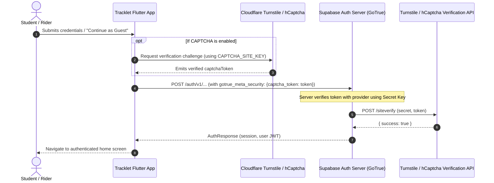

# Supabase CAPTCHA Bot & Abuse Protection Architecture

## 1. Overview & Security Objectives

Supabase Authentication provides native bot and abuse protection via CAPTCHA verification on all public authentication endpoints:
- User Registration (`signUp`)
- Email & Password Login (`signInWithPassword`)
- Password Reset Requests (`resetPasswordForEmail`)
- OTP / Verification Resends (`resend`)
- Anonymous Guest Sign-ins (`signInAnonymously`)

This prevents automated credential stuffing attacks, bulk spam registrations, distributed brute-force attempts on student accounts, and denial-of-service spam on campus email delivery systems.

Tracklet supports both **Cloudflare Turnstile** (privacy-first, invisible/smart CAPTCHA) and **hCaptcha**.



---

## 2. Supabase Integration Architecture

### 2.1 Server-Side Verification
When CAPTCHA protection is enabled on the Supabase project:
1. Supabase GoTrue intercepts auth requests on `/signup`, `/token`, `/recover`, and `/otp`.
2. It extracts `gotrue_meta_security.captcha_token` from the request body.
3. If the token is missing, invalid, or expired, GoTrue rejects the request immediately with HTTP 400 (`captcha_failed` / `Captcha protection is enabled for this project. Please provide a valid captcha token.`).
4. When present, GoTrue contacts the configured CAPTCHA provider (`https://challenges.cloudflare.com/turnstile/v0/siteverify` or `https://hcaptcha.com/siteverify`) with the project's **Secret Key**.
5. Only upon successful verification does GoTrue proceed to issue JWT tokens, send emails, or insert records.

### 2.2 Client-Side Contract Invariants
In Tracklet's Dart data layer (`lib/data/auth/auth_repository.dart`):
- All mutating authentication methods accept an optional `String? captchaToken` parameter:
  - `signInWithEmail(email, password, {String? captchaToken})`
  - `signUpWithEmail(email, password, {String? fullName, String? captchaToken})`
  - `resetPasswordForEmail(email, {String? redirectTo, String? captchaToken})`
  - `resendVerificationEmail(email, {String? captchaToken})`
  - `signInAnonymously({String? captchaToken})`
- The `SupabaseAuthRepository` forwards `captchaToken` directly to `supabase_flutter`'s GoTrue client, which sets the canonical `gotrue_meta_security: {'captcha_token': captchaToken}` payload.
- Error mapper `_mapAuthError` intercepts CAPTCHA challenge failures and renders a clean, actionable message:
  `"CAPTCHA verification challenge failed or required. Please complete the verification challenge and try again."`

---

## 3. Configuration & Setup Guide

### 3.1 Step 1: Obtain Keys from CAPTCHA Provider

#### Option A: Cloudflare Turnstile (Recommended)
1. Sign in to the [Cloudflare Dashboard](https://dash.cloudflare.com/).
2. Navigate to **Turnstile** $\to$ **Add Widget**.
3. Set the widget name (e.g. `Tracklet NITC Transit`).
4. Add your domain(s):
   - Production web domain: `tracklet.nitc.ac.in` (or deployed hosting URL)
   - Development domains: `localhost`, `127.0.0.1`
5. Select the widget mode: **Managed** (interactive challenge only when required) or **Non-interactive / Invisible**.
6. Copy both the **Site Key** (public) and **Secret Key** (private).

#### Option B: hCaptcha
1. Sign up on [hCaptcha.com](https://www.hcaptcha.com/).
2. Create an **Active Site** and copy the public **Sitekey**.
3. Under **Account Settings**, copy your **Secret key**.

---

### 3.2 Step 2: Enable Protection in Supabase Project

1. Navigate to the **Supabase Dashboard** for project `fnngudikrvelpuhngtlw`:
   `https://supabase.com/dashboard/project/fnngudikrvelpuhngtlw/auth/protection`
2. Scroll to **Bot and Abuse Protection** $\to$ **Enable CAPTCHA protection**.
3. Toggle the protection switch to **ON**.
4. Choose your provider:
   - **Cloudflare Turnstile** or **hCaptcha**.
5. Paste the provider's **Secret Key**.
6. Click **Save Changes**.

---

### 3.3 Step 3: Configure Flutter Client Build Variables

Pass the configuration via `--dart-define` or `config/env.json`:

```bash
flutter run \
  --dart-define=CAPTCHA_ENABLED=true \
  --dart-define=CAPTCHA_PROVIDER=turnstile \
  --dart-define=CAPTCHA_SITE_KEY=0x4AAAAAA...
```

The configuration is accessible compile-time via `AppConfig`:
- `AppConfig.captchaEnabled` (`bool`)
- `AppConfig.captchaSiteKey` (`String`)
- `AppConfig.captchaProvider` (`String`, default `'turnstile'`)
- `AppConfig.isCaptchaConfigured` (`bool`)

---

## 4. Frontend Implementation Strategies (Web vs Mobile)

### 4.1 Flutter Web
For Flutter Web deployments:
1. Include the Turnstile or hCaptcha script in `web/index.html`:
   ```html
   <script src="https://challenges.cloudflare.com/turnstile/v0/api.js?render=explicit" async defer></script>
   ```
2. Render the widget container using an `HtmlElementView` or Dart JS-Interop call:
   ```javascript
   turnstile.render('#turnstile-container', {
     sitekey: window.CAPTCHA_SITE_KEY,
     callback: function(token) {
       // dispatch event to Dart window listener
     }
   });
   ```

### 4.2 Flutter Mobile (Android & iOS)
On mobile native builds:
1. Cloudflare Turnstile does not provide an official mobile SDK, but operates inside an embedded, lightweight `InAppWebView` or modal bottom sheet loading a secure local asset page.
2. For hCaptcha, the official `hcaptcha_flutter` SDK provides native Android and iOS verification modals with hardware security evaluation.
3. The resulting token string is passed directly into `authNotifier.signIn(..., captchaToken: token)`.

---

## 5. Security & Invariant Checklist

| Invariant | Status | Verification |
|---|---|---|
| **Zero Secret Leakage** | Confirmed | CAPTCHA Secret Key is stored exclusively in Supabase backend; never bundled into Flutter client binary or Git. |
| **Backward Compatibility** | Confirmed | All `captchaToken` parameters are optional (`String?`). Existing test suites and local development without CAPTCHA continue running cleanly. |
| **Clean Error Mapping** | Confirmed | Unhandled raw `AuthException` with `captcha` details is mapped into a localized, user-friendly message. |
| **Defense-in-Depth** | Confirmed | Works in combination with Fastify rate limiting (10 auth reqs/min) and database domain constraints (`@nitc.ac.in`). |
