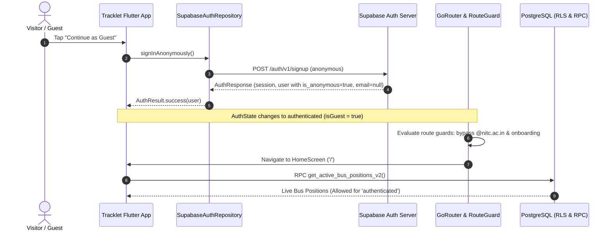

# Guest Authentication & Anonymous Rider Architecture

## 1. Overview & Objectives

Tracklet provides a frictionless, zero-barrier **"Continue as Guest"** onboarding path for campus visitors, prospective students, and riders who need immediate bus tracking without registering an account.

Guest mode uses official **Supabase Anonymous Authentication** (`client.auth.signInAnonymously()`). It creates a real authenticated user session backed by Supabase Auth with an immutable UUID in `auth.users` (`is_anonymous = true`), rather than a mock login, local simulated session, or hardcoded guest identifier.



---

## 2. Identity Semantics & Session Lifecycle

### 2.1 Identity Invariants
1. **Canonical UUID:** Every guest user receives a genuine Supabase user UUID (`user.id`). This ID is persistent across the lifetime of the session.
2. **Identity Flag:** The identity is identified canonically via `user.isAnonymous == true`. No client-side ad-hoc flags (such as `isGuest: true` in local storage) are treated as proof of authentication.
3. **Null Email:** Anonymous auth users have `user.email == null` and no verified email identities in `user.identities`.

### 2.2 Session Persistence & Restoration
- Guest sessions are stored securely in device storage by `SupabaseFlutter.initialize()` using platform-secure storage (`flutter_secure_storage` on mobile / `localStorage` on web).
- When the app restarts, Supabase automatically restores the existing session.
- The `AuthRepository` stream emits the restored `AuthState(status: AuthStatus.authenticated, user: user)`.
- Because `user.isAnonymous == true`, `AuthState.isGuest` evaluates to `true`, and the user is immediately routed to the home screen without seeing the login or onboarding screens.

### 2.3 Exiting Guest Mode
- In Settings under **Account Actions**, guests are presented with **Exit Guest Mode**.
- Tapping **Exit Guest Mode** calls `authRepository.signOut()`, terminating the anonymous session on Supabase and clearing local storage.
- The route guard transitions state to `AuthStatus.unauthenticated`, immediately redirecting the user to `/login`.

---

## 3. Guest vs. Registered-User Authorization Matrix

The security boundary separates read-only campus transit consumption from institutional features and privileged administrative operations:

| Feature / Domain | Guest User (`is_anonymous = true`) | Registered Student (`@nitc.ac.in`) | Fastify Gateway / Admin | Enforcement Mechanism |
|---|---|---|---|---|
| **View Active Buses** | Read-Only | Read-Only | Read-Only | PostgreSQL RPC `get_active_bus_positions_v2()` (`GRANT EXECUTE TO authenticated, anon`) |
| **View Routes & Stops** | Read-Only | Read-Only | Read-Only | PostgreSQL RLS on `routes`, `stops`, `route_stops` (`SELECT TO authenticated, anon`) |
| **View Stop Events** | Read-Only | Read-Only | Read-Only | PostgreSQL RPC `get_active_trip_stop_events()` (`GRANT EXECUTE TO authenticated, anon`) |
| **View Timings & Buildings** | Read-Only | Read-Only | Read-Only | PostgreSQL RLS on `bus_timings`, `campus_buildings` |
| **Profile Sync & Onboarding** | **Bypassed / Synthesized** | Enforced & Persistent | N/A | Local profile repository synthesizes guest profile; avoids RPC `ensure_my_profile` |
| **Institutional Account Management**| **Disabled** | Change Password / Delete Account | N/A | UI adaptation in `SettingsScreen` |
| **Trip Start / End Lifecycle** | **Forbidden** | **Forbidden** | Privileged Access | Fastify endpoint / `service_role` |
| **Telemetry Ingestion** | **Forbidden** | **Forbidden** | Privileged Access | PostgreSQL RPC `ingest_telemetry_packet()` (`GRANT EXECUTE TO service_role ONLY`) |
| **Device Provisioning & Reset** | **Forbidden** | **Forbidden** | Privileged Access | PostgreSQL RPCs `register_tracking_device()`, `reset_device_sequence()` (`service_role ONLY`) |

---

## 4. Profile Synchronization & Database Boundary

### 4.1 Database Trigger Safety
When an anonymous user signs in:
1. Supabase Auth inserts a record into `auth.users` with `is_anonymous = true` and `email = NULL`.
2. The `public.handle_new_user()` trigger fires on `auth.users`, creating a matching row in `public.users(user_id, onboarding_completed)` with `onboarding_completed = false`.
3. Triggers do not fail because `public.users.email` is nullable in the catalog.

### 4.2 RPC Isolation (`is_authorized_nitc_user`)
The database functions `ensure_my_profile()`, `get_my_profile()`, `update_my_profile()`, and `complete_onboarding()` invoke `is_authorized_nitc_user()`, which validates:
```sql
IF auth.jwt() ->> 'email' NOT LIKE '%@nitc.ac.in' THEN
    RAISE EXCEPTION 'Unauthorized: must use institutional NITC email'
        USING ERRCODE = '42501';
END IF;
```
If an anonymous user were to call these RPCs, the call would be rejected with error `42501`.

### 4.3 Flutter Profile Layer Adaptation
To prevent runtime exceptions, `LocalOrSupabaseProfileRepository` checks `currentUser.isAnonymous`:
- **`getProfile()`**: If `currentUser.isAnonymous == true`, it skips remote RPCs and returns an in-memory guest profile:
  ```dart
  Profile(
    id: currentUser.id,
    name: 'Guest Rider',
    email: '',
    role: 'Guest',
    hasCompletedOnboarding: true,
  )
  ```
- **`saveProfile()` & `setOnboardingCompleted()`**: Remote RPC invocations are cleanly bypassed for anonymous sessions, avoiding 42501 database errors.
- **`router.dart`**: Route guards recognize `isGuest` and skip the onboarding redirect:
  ```dart
  final isGuest = authState.isGuest;
  final onboardingComplete = isGuest || (profile?.hasCompletedOnboarding ?? false);
  ```

---

## 5. Account Linking & Upgrade Path

Supabase Auth natively supports converting an anonymous account into a permanent authenticated account without losing the user UUID:

```dart
// Future enhancement: Link guest user to permanent institutional email
await supabase.auth.updateUser(
  UserAttributes(
    email: 'student@nitc.ac.in',
    password: newPassword,
  ),
);
```

In Tracklet:
- In `SettingsScreen`, Section 2 displays an **Account Upgrade** prompt informing the guest that they can sign in with their `@nitc.ac.in` email to unlock student profiles, batch schedules, and academic features.
- If the user logs out and signs in with Google OAuth or email, standard `@nitc.ac.in` domain verification takes over.

---

## 6. Required Supabase Project Configuration

To enable anonymous logins on any Supabase project connected to Tracklet:

1. Open the **Supabase Dashboard**: `https://supabase.com/dashboard/project/<project-id>/auth/providers`.
2. Navigate to **Authentication** $\to$ **Sign In / Up** $\to$ **Anonymous Sign-in**.
3. Toggle **Enable Anonymous sign-ins** to **ON**.
4. Save changes.

*Verification via CLI/HTTP:*
```bash
curl -s "https://<project-id>.supabase.co/auth/v1/settings" \
  -H "apikey: <anon_key>" | jq '.external.anonymous_users'
# Must return: true
```
If disabled on the server, `signInAnonymously()` gracefully captures the error and displays:
`"Guest login is currently disabled by campus administrator. Please sign in with your NITC email."`
